# 🏨 Hotel Business Analytics
### Investigating Hotel Business Using Data Visualization

<p align="center">
  <strong>Understanding Booking & Cancellation Behaviour</strong>
</p>

<p align="center">
  An end-to-end data analytics project exploring hotel booking patterns, cancellation behaviour, customer segmentation, revenue performance, and seasonal trends through exploratory data analysis and an interactive Streamlit dashboard.
</p>

<p align="center">
  
  
  
  
  
</p>

---

## 📑 Table of Contents

- [Project Overview](#-project-overview)
- [Business Problem](#-business-problem)
- [Project Objectives](#-project-objectives)
- [Business Questions](#-business-questions)
- [Dataset Overview](#-dataset-overview)
- [Analytical Workflow](#-analytical-workflow)
- [Interactive Dashboard Gallery](#-interactive-dashboard-gallery)
- [EDA Visualization Gallery](#-eda-visualization-gallery)
- [Technology Stack](#-technology-stack)
- [Repository Structure](#-repository-structure)
- [Installation and Execution](#-installation-and-execution)
- [Business Recommendations](#-business-recommendations)
- [Limitations](#-limitations)
- [Future Enhancements](#-future-enhancements)
- [Conclusion](#-conclusion)
- [Author](#-author)

---

## 📌 Project Overview

The **Hotel Business Analytics Project** investigates hotel reservation data to understand booking behaviour, analyze cancellation patterns, examine customer segments, and explore seasonal variations in demand.

The project combines data preparation, exploratory data analysis (EDA), data visualization, and interactive dashboard development to transform raw reservation records into meaningful business insights.

The Streamlit dashboard presents dedicated analytical views for booking performance, cancellations, revenue, customer behaviour, hotel performance, seasonal trends, business insights, and data exploration.

### Key Project Highlights

- Data cleaning and quality assessment
- Exploratory Data Analysis (EDA)
- Booking distribution and cancellation analysis
- Revenue and hotel performance investigation
- Customer and booking-segment analysis
- Monthly and seasonal trend analysis
- Interactive Plotly visualizations
- Streamlit dashboard development
- Business-focused analytical recommendations

---

## 🎯 Business Problem

Hotel businesses must manage fluctuating demand, changing customer preferences, and reservation cancellations while maintaining efficient room allocation and revenue planning.

Cancellations can introduce uncertainty into occupancy planning and expected revenue. Differences in booking channels, customer characteristics, and reservation timing may provide useful information for understanding cancellation behaviour.

This project applies exploratory analysis and visualization to identify booking patterns, examine cancellation trends, and develop evidence-based recommendations for hotel business decision-making.

---

## 🎯 Project Objectives

1. Analyze hotel booking patterns and reservation distributions.
2. Investigate cancellation rates and booking-status patterns.
3. Examine revenue-related indicators where supported by the dataset.
4. Understand customer types and distribution-channel behaviour.
5. Identify monthly and seasonal booking trends.
6. Explore lead time, length of stay, and other relevant booking characteristics.
7. Assess data quality and prepare analytical features.
8. Communicate findings through interactive visualizations.
9. Develop practical recommendations based on the analytical results.

---

## 🔍 Business Questions

### Booking Behaviour
- How are reservations distributed across hotel types?
- How does booking volume change over time?
- What booking characteristics are most common?

### Cancellation Behaviour
- What proportion of reservations are cancelled?
- How do cancellation rates differ across relevant booking segments?
- How is cancellation behaviour associated with reservation lead time?
- What patterns appear in booking status and cancellation indicators?

### Customer Behaviour
- How do new and repeat guests differ in booking behaviour?
- Which customer groups contribute the most reservations?
- How do booking channels and market segments compare?

### Business Performance
- What monthly and seasonal patterns are visible?
- How do available revenue-related metrics vary?
- Which findings could support more effective inventory planning?

---

## 📂 Dataset Overview

**Dataset:** `hotel_bookings_data.csv`

The project uses hotel reservation data containing booking, customer, arrival, and stay-related attributes.

| Category | Example Attributes |
|---|---|
| Booking Information | Hotel type, reservation characteristics |
| Cancellation | Cancellation indicator, booking status |
| Arrival Information | Arrival date, arrival month |
| Customer Details | Guest type, adults, children |
| Reservation Timing | Lead time, booking changes |
| Stay Information | Weeknight and weekend stays |
| Booking Channels | Market segment, distribution channel |
| Pricing | Average daily rate (ADR), if available |

*The actual column names, row count, and dataset dimensions should be verified against the source file.*

### Data Preparation

- Inspect dataset dimensions and data types.
- Identify missing values and duplicate records.
- Validate numerical and categorical fields.
- Handle data inconsistencies where appropriate.
- Derive relevant date-based and booking-related features.
- Validate cancellation indicators and calculated metrics.
- Prepare the cleaned data for analysis and visualization.

---

## ⚙️ Analytical Workflow

| Phase | Activities |
|---|---|
| 01 — Data Acquisition | Load the hotel booking dataset |
| 02 — Data Understanding | Inspect dimensions, columns, and data types |
| 03 — Data Quality | Evaluate missing values, duplicates, and inconsistencies |
| 04 — Data Preparation | Clean and transform relevant fields |
| 05 — Feature Engineering | Create derived booking and time-based features |
| 06 — Exploratory Analysis | Investigate booking and cancellation behaviour |
| 07 — Visualization | Communicate patterns through charts |
| 08 — Dashboard Development | Present findings in Streamlit |
| 09 — Business Interpretation | Formulate evidence-based recommendations |

---

# 🖥️ Interactive Dashboard Gallery

The `dashboard-previews/` directory contains screenshots of the interactive Streamlit dashboard. Each preview represents a dedicated analytical page.

> Ensure the filenames below match the actual images in your GitHub repository. The image names are based on the dashboard files previously shared.

### 01. Executive Overview

<p align="center">
  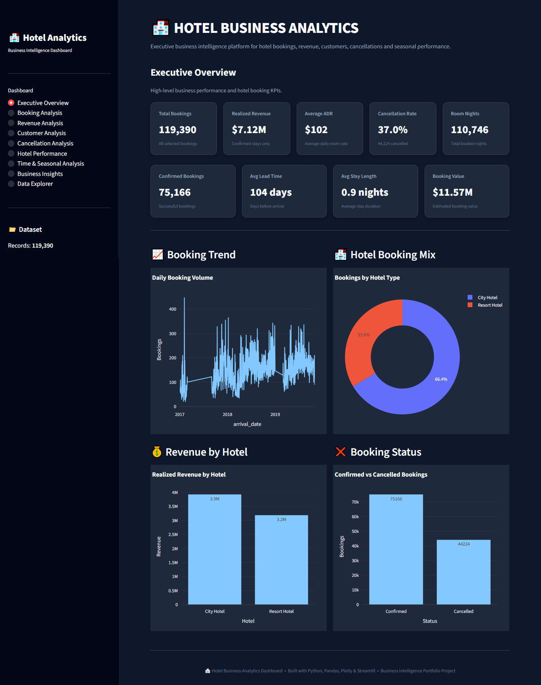
</p>

*High-level overview of hotel booking performance and key analytical indicators.*

### 02. Booking Analysis

<p align="center">
  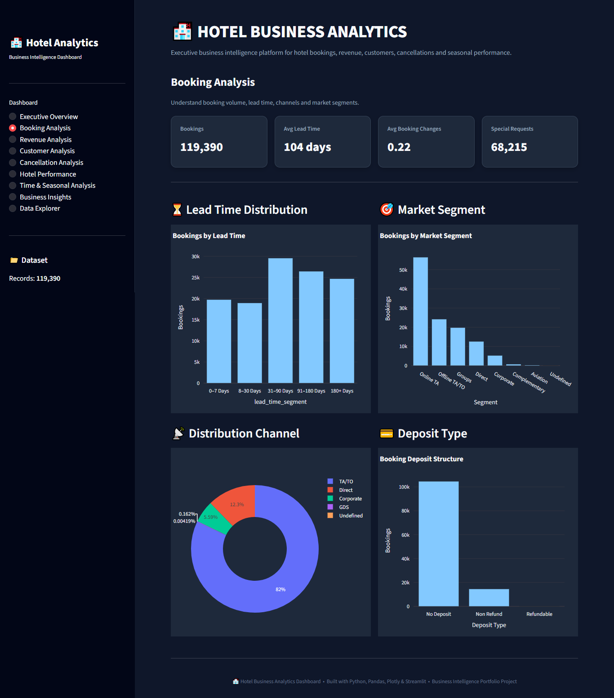
</p>

*Exploration of reservation volumes, booking characteristics, and booking distribution.*

### 03. Cancellation Analysis

<p align="center">
  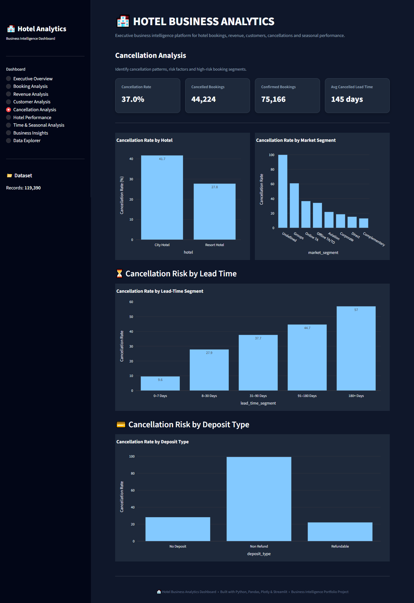
</p>

*Analysis of cancelled reservations and cancellation patterns across relevant booking segments.*

### 04. Revenue Analysis

<p align="center">
  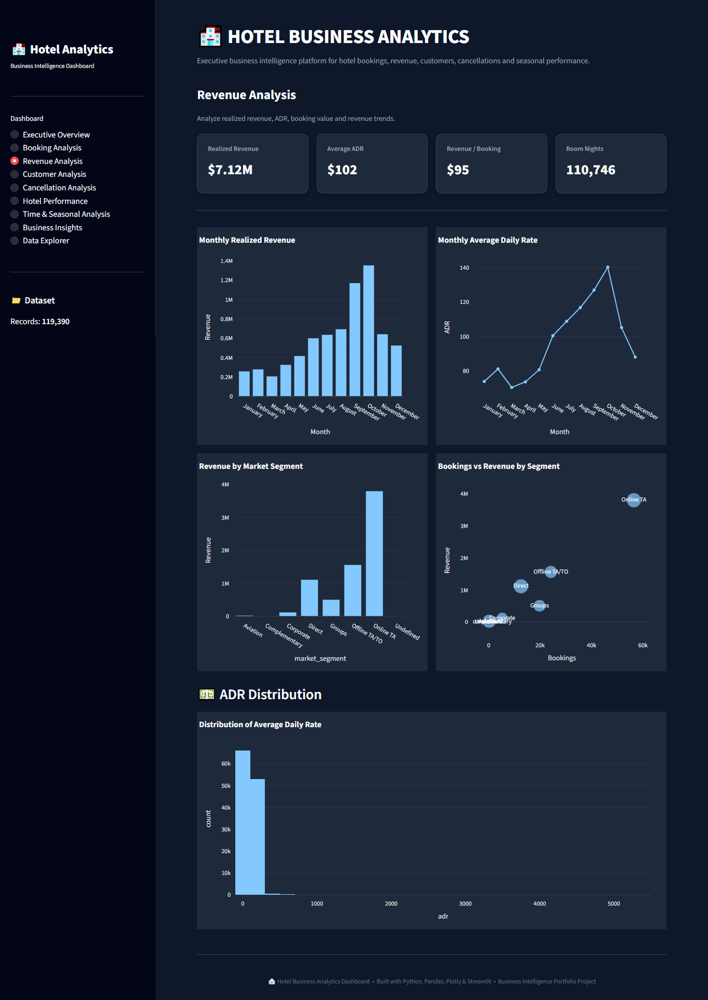
</p>

*Investigation of available revenue and pricing indicators.*

### 05. Customer Analysis

<p align="center">
  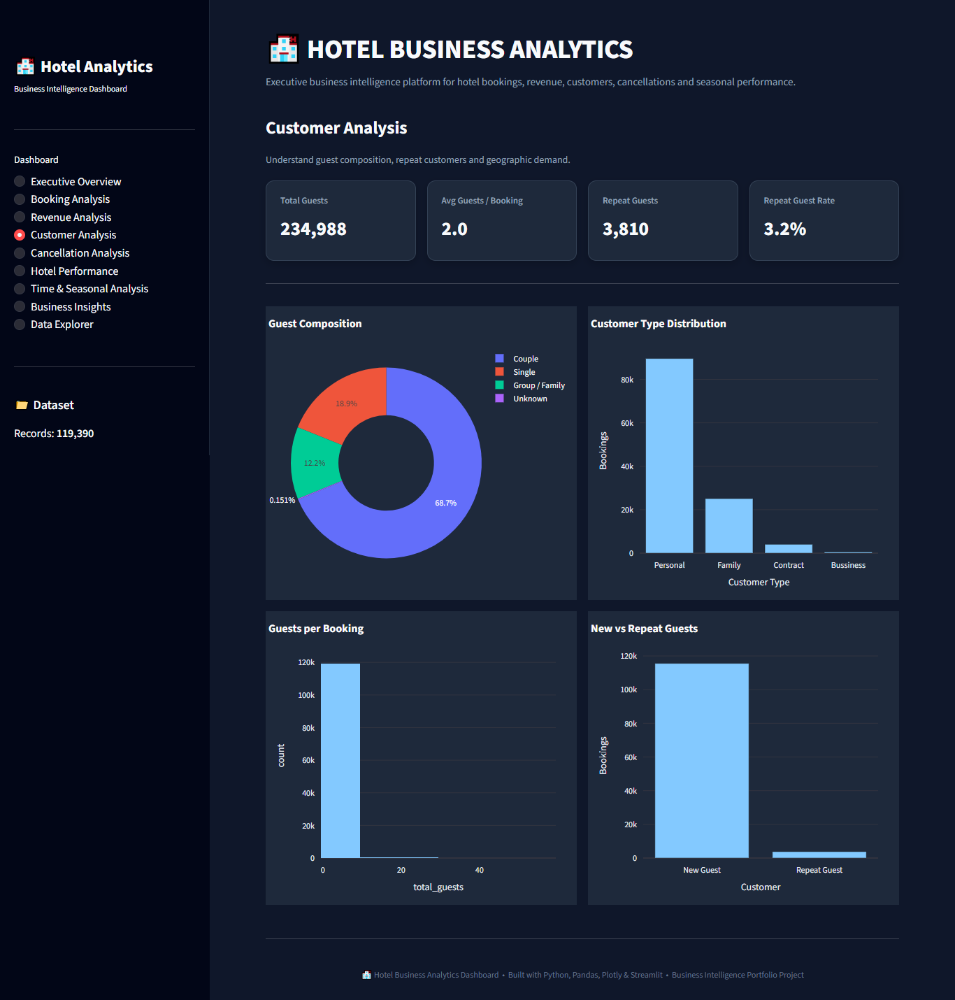
</p>

*Exploration of customer characteristics and booking behaviour.*

### 06. Hotel Performance

<p align="center">
  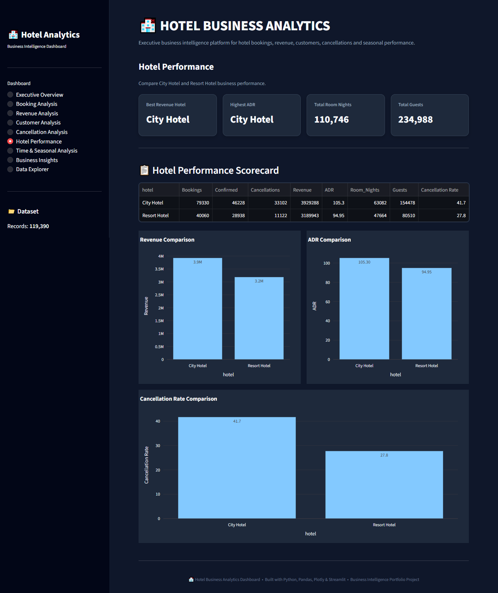
</p>

*Comparison of hotel performance using the metrics available in the dataset.*

### 07. Time and Seasonal Analysis

<p align="center">
  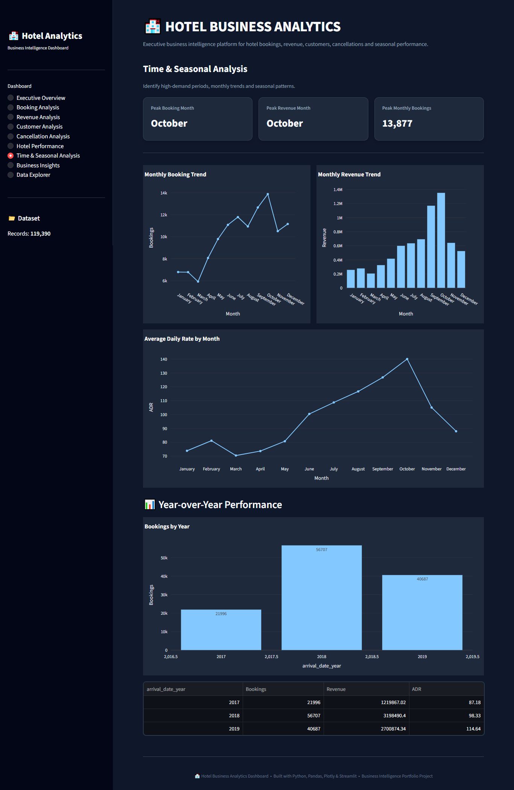
</p>

*Investigation of booking trends across arrival periods and seasons.*

### 08. Business Insights

<p align="center">
  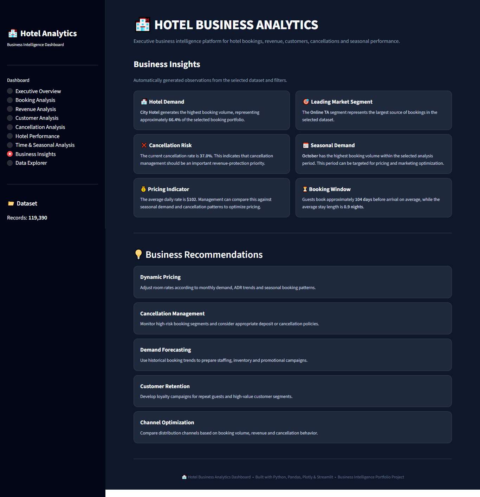
</p>

*Summary of analytical findings and potential business actions.*

### 09. Data Explorer

<p align="center">
  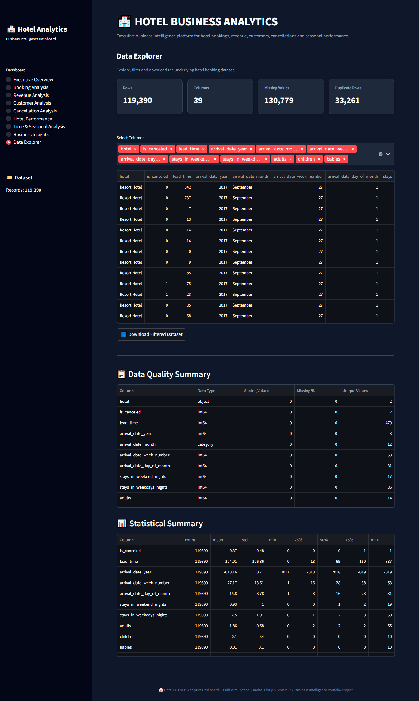
</p>

*Exploration of the underlying hotel booking data.*

---

# 📊 EDA Visualization Gallery

The `previews/` directory contains supporting charts produced during exploratory data analysis. These visualizations provide a closer look at booking distributions, cancellation patterns, and customer behaviour.

### 01. Exploratory Data Analysis Overview

<p align="center">
  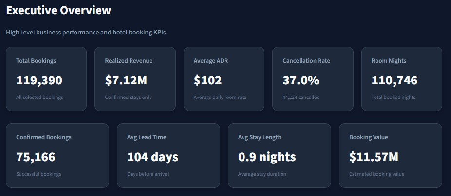
</p>

*High-level overview of the dataset and exploratory analysis.*

### 02. Booking Share by Category

<p align="center">
  
</p>

*Comparison of booking distribution across the categories represented in the chart.*

### 03. Monthly Booking Trends

<p align="center">
  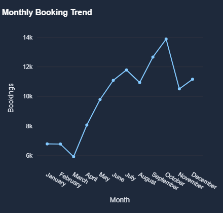
</p>

*Examination of monthly booking patterns and potential seasonality.*

### 04. Cancellation Rate Analysis

<p align="center">
  
</p>

*Investigation of cancellation rates across the categories included in the visualization.*

### 05. Cancellation Status Distribution

<p align="center">
  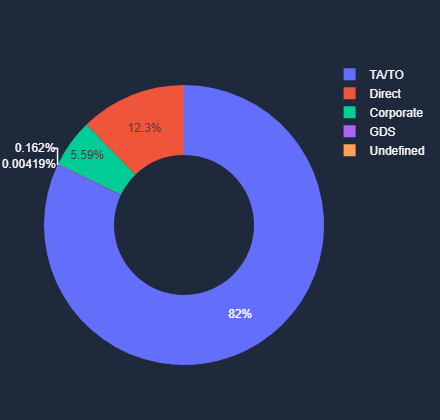
</p>

*Comparison of reservation statuses and cancellation outcomes.*

### 06. Cancellation Rate Comparison I

<p align="center">
  
</p>

*Additional comparison of cancellation behaviour. Update the title to reflect the actual chart dimensions.*

### 07. Cancellation Rate Comparison II

<p align="center">
  
</p>

*Further investigation of cancellation patterns across relevant booking characteristics.*

### 08. Cancellation Rate Comparison III

<p align="center">
  
</p>

*Additional cancellation analysis to support segment-level interpretation.*

### 09. New versus Repeat Guests

<p align="center">
  
</p>

*Comparison of new and repeat guest behaviour, subject to the categories available in the dataset.*

**Image naming note:** The screenshot of your Windows folder truncates several filenames. The comparison filenames above are suggested names, not verified original filenames. Rename the files accordingly or change the image paths to match the exact names stored in `previews/`.

---

## 🛠️ Technology Stack

| Technology | Purpose |
|---|---|
| Python | Core programming and analysis |
| Pandas | Data cleaning and manipulation |
| NumPy | Numerical operations |
| Matplotlib | Data visualization |
| Seaborn | Statistical visualization |
| Plotly | Interactive charts |
| Streamlit | Dashboard development |
| Jupyter Notebook / Google Colab | Exploratory analysis |
| Git and GitHub | Version control and project sharing |

*Keep only the technologies actually used in your implementation.*

---

## 📁 Repository Structure

```text
hotel-booking-cancellation-analysis/
│
├── README.md
├── hotel_bookings_data.csv
├── hotel_business_analysis.ipynb
├── app.py
├── requirements.txt
│
├── dashboard-previews/
│   ├── booking-analysis.png
│   ├── business-insights.png
│   ├── cancellation-analysis.png
│   ├── customer-analysis.png
│   ├── data-explorer.png
│   ├── executive-overview.png
│   ├── hotel-performance.png
│   ├── revenue-analysis.png
│   └── time-&-seasonal-analysis.png
│
├── previews/
│   ├── Booking-Share-by-Category.png
│   ├── Cancellation-Rate-Analysis.png
│   ├── Cancellation-Status-Distribution.png
│   ├── Cancellation-Rate-Comparison-1.png
│   ├── Cancellation-Rate-Comparison-2.png
│   ├── Cancellation-Rate-Comparison-3.png
│   ├── EDA-overview.jpg
│   ├── Monthly-Booking-Trends.png
│   └── New-vs-Repeat-Guests.png
│
└── reports/
    ├── hotel-business-analysis-report.pdf
    └── hotel-analysis-presentation.pptx
```

*This is a suggested structure. Keep only files and directories that exist in your repository.*

---

## 🚀 Installation and Execution

### Prerequisites

- Python 3.10 or a compatible version
- pip package manager
- Git (optional)

### 1. Clone the Repository

```bash
git clone https://github.com/YOUR-USERNAME/hotel-booking-cancellation-analysis.git
```

Replace `YOUR-USERNAME` with your GitHub username.

### 2. Navigate to the Project Directory

```bash
cd hotel-booking-cancellation-analysis
```

### 3. Create a Virtual Environment

```bash
python -m venv .venv
```

Activate it on Windows:

```bash
.venv\Scripts\activate
```

### 4. Install Dependencies

```bash
pip install -r requirements.txt
```

### 5. Run the Streamlit Dashboard

```bash
python -m streamlit run app.py
```

Open the local URL displayed in your terminal.

To run the notebook, open `hotel_business_analysis.ipynb` in Jupyter Notebook or Google Colab and execute the cells in sequence.

---

## 💡 Business Recommendations

Potential recommendations to investigate using the actual analytical findings include:

- **Cancellation Management:** Monitor cancellation rates by customer group, booking channel, and lead time.
- **Inventory Planning:** Use historical reservation patterns to support room allocation and demand planning.
- **Seasonal Planning:** Align staffing and promotional planning with observed booking trends.
- **Customer Engagement:** Investigate targeted communication strategies for customer groups with different booking patterns.
- **Booking Policy Evaluation:** Review deposit and cancellation policies using observed reservation behaviour.
- **Performance Monitoring:** Track booking and cancellation indicators through a consistent reporting dashboard.

Recommendations should be finalized using validated findings rather than assumed outcomes.

---

## ⚠️ Limitations

- Data quality and completeness may influence the analysis.
- Historical trends may not represent future booking behaviour.
- Observed associations do not necessarily establish causation.
- Revenue-related findings depend on the available fields and calculation assumptions.
- Recommendations require validation against the hotel's operational context.

---

## 🔮 Future Enhancements

- Build a cancellation-risk prediction model.
- Develop demand forecasting capabilities.
- Add advanced filters and interactive chart selections.
- Automate data-quality checks.
- Deploy the dashboard online.
- Integrate regularly updated data sources.

---

## 🏁 Conclusion

The **Hotel Business Analytics Project** demonstrates how exploratory data analysis and visualization can be applied to hospitality business challenges.

By investigating booking distributions, cancellation behaviour, customer characteristics, and temporal trends, the project provides a structured approach to understanding reservation data and identifying opportunities for improved business decisions.

The combination of analytical notebooks, visualization galleries, and an interactive Streamlit dashboard demonstrates practical skills in data preparation, exploratory analysis, visual communication, and business intelligence.

---

## 👨‍💻 Author

**Ayush Dash**

Data Analytics · Business Intelligence · Data Visualization

Focused on transforming raw data into meaningful insights through analytical thinking, data visualization, and business-oriented problem-solving.

---

<p align="center">
  <strong>Hotel Business Analytics</strong><br/>
  Turning Booking Data into Business Insights
</p>
